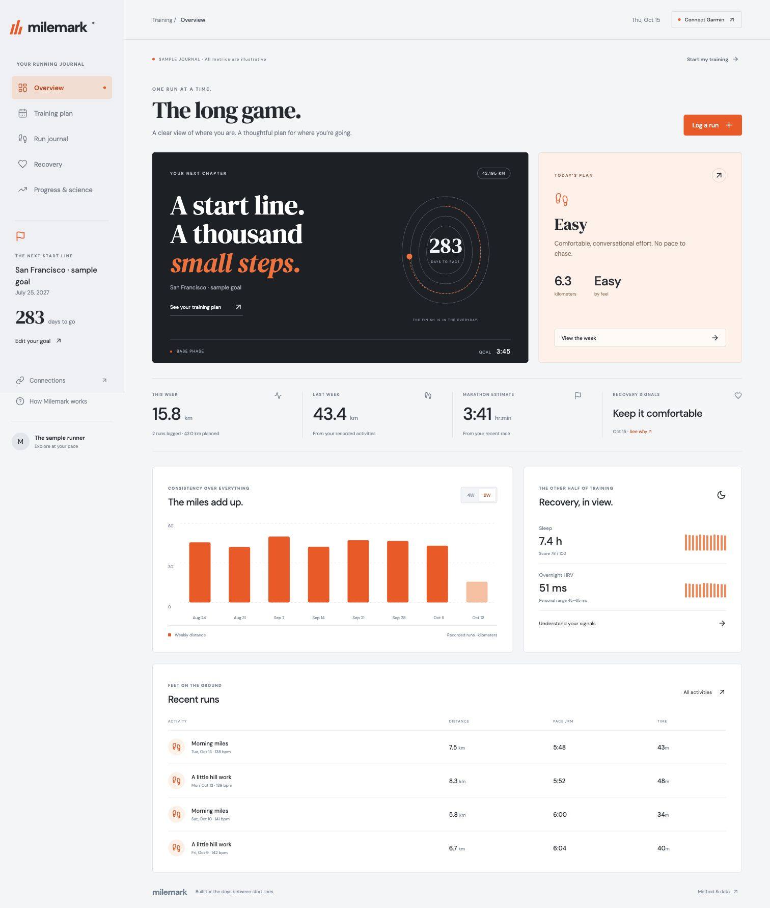

# Milemark

**The long game.** A personal marathon training dashboard built with React, TypeScript, and Python. A bright orange and charcoal interface brings your training plan, run journal, and recovery history together.



## What works

- Marathon selection: upcoming Los Angeles, Tokyo, Boston, and San Francisco events, plus a custom name and date. Preset dates link to organizer sources; past events are automatically hidden.
- A training template based on your current mileage, longest run, running days, and race date. Includes base weeks, gradual progression, recovery weeks, and a taper.
- Weekly distance charts, run history, manual logging, recovery check-ins, and race-based marathon estimates.
- VO₂ max, cadence, resting/max heart rate, running power, training effect, ground-contact time, and Garmin race predictions where the device provides them.
- A Progress & science page with source links, clear evidence limits, and comparisons of actual comparable race efforts.
- Local Garmin sign-in and MFA, cached session tokens, and read-only imports of runs, sleep, and HRV. Uses the **unofficial** `garminconnect` Python client, not Garmin's enterprise API.
- Miles by default, with a persistent miles/kilometers switch for distances, pace, goal inputs, and calendar exports. Stored/imported distances remain canonical kilometers.
- Browser-local manual mode for runners without Garmin. JSON import/export and `.ics` calendar downloads.
- Clearly labeled synthetic demo data. Personal data is never mixed with the sample runner.

**Live Garmin sign-in and read-only import were verified with the owner’s account on October 15, 2026.** The adapter uses installed `garminconnect` 0.3.18; login/MFA/data contracts also have fixture tests. Individual account behavior can differ. Garmin can change or restrict its services, and recovery metrics depend on the device.

## Run locally

Requirements: Node.js 20.19+ or 22.12+, npm, and Python 3.12+.

On macOS, double-click **`start.command`** (or run `./start.command` in Terminal). It prepares dependencies, builds the frontend, opens your browser, and starts the service on `http://127.0.0.1:8000`. Keep its Terminal window open; press Control-C to stop.

Or set it up manually:

```sh
npm ci
python3.12 -m venv .venv
.venv/bin/python -m pip install -r backend/requirements.lock.txt
npm run build
PYTHONPATH=backend .venv/bin/python -m uvicorn milemark.app:app --host 127.0.0.1 --port 8000 --no-access-log
```

Open `http://127.0.0.1:8000`. Select **Connect Garmin**, sign in locally, enter Garmin's verification code if requested, then choose **Sync my Garmin**. Sync can take a few minutes. To build your plan from imported training, open **Edit your goal → Use my last 4 complete weeks** and review the numbers before saving.

No Garmin? Choose **Start my training**, select your race and current training volume, then log runs manually. Goal time and mileage defaults are editable examples, not measurements of your fitness.

### Development

```sh
# Terminal 1: local Python API
PYTHONPATH=backend .venv/bin/python -m uvicorn milemark.app:app --host 127.0.0.1 --port 8000 --no-access-log
# Terminal 2: React with hot reload, API proxied to Python
npm run dev
```

The frontend is also a static app: `npm run build` produces `dist/`. Its hosted preview supports demo/manual mode; Garmin authentication is deliberately available only in the local Python app. It does not expose the laptop's API to the internet.

## How planning works

The plan keeps its original start date across reloads. Editing a goal starts a new schedule from the current week.

The engine is deterministic and inspectable in `frontend/src/engine.ts`. It is **not a trained ML model** or a medical assessment.

- Earlier months progressively build the base toward an explicit peak-mileage target instead of freezing the starting volume. The default four-day target is 35 miles/week; goal settings let the runner edit it.
- Progression is calculated from starting volume, target peak, and available growth weeks, capped at 6% between ordinary build weeks. Every fourth week is reduced. If the target is unreachable within the timeline, the app shows the attainable peak and warns rather than forcing the mileage. These are app parameters, not proven injury-prevention thresholds.
- Long runs: no more than 18 miles or 45–50% of weekly volume, depending on running frequency. Schedules preserve at least one nonrunning day. Short timelines generate explicit warnings.
- Recovery: sleep below 6 hours, a sleep score below 60, or seven-day HRV outside the personal baseline suggests an easy session 20% shorter **today only**. Missing or stale data makes no readiness claim. Calendar exports contain the base schedule.
- Finish estimate: the Riegel formula with exponent 1.06, using an explicitly marked race or user-entered race time. Easy training runs are never treated as race efforts. Course, weather, durability, and training history can make actual results differ substantially.
- Goal pace is a target, not proof of current ability. Most sessions use conversational effort rather than an unsupported pace prescription.

Research-to-code mappings and limitations are visible in the app and in `frontend/src/evidence.ts`. Software tests do not prove training effectiveness.

The [B.A.A. training materials](https://www.baa.org/races/boston-marathon/info-for-athletes/boston-marathon-training/) informed the structure of base/build/recovery work; this app does not reproduce a B.A.A. plan. [Garmin's HRV guide](https://www.garmin.com/en-US/garmin-technology/health-science/hrv-status/) explains why personal baselines matter.

## Data & privacy

The local Python service stores only normalized run/recovery summaries in ignored `backend/data/milemark.sqlite3`. Session tokens are stored separately in ignored `backend/data/garmin/` with owner-only permissions. Passwords are not saved. Raw Garmin responses, GPS tracks, and account profile details are not exported or committed.

Browser manual records and settings use local storage. Export before clearing browser data. **Disconnect & remove local import** clears the local Garmin tokens, cached snapshot, and current browser journal. It does not revoke tokens already issued by Garmin; use Garmin account settings for revocation if needed. JSON imports replace the browser journal. Exported journals contain personal activity/recovery information, so review them before sharing.

The backend binds to loopback, checks Host/Origin, requires a per-process request token for mutations, redacts Garmin exception details, and rejects overlapping sync/login requests. This is a single-user local tool, not a multi-user hosted authentication service. Don't bind it to a public network interface.

Garmin's [official developer program](https://developer.garmin.com/gc-developer-program/program-faq/) requires approval for business use. A future supported multi-user integration should use that program rather than collecting Garmin passwords on a hosted website.

## Checks

```sh
npm test
npm run build
PYTHONPATH=backend .venv/bin/python -m pytest backend/tests -q
```

Tests cover planning bounds, taper/race dates, stale and missing recovery, race-only prediction inputs, calendar generation, import validation, Garmin normalization/MFA calls, local API protection, redacted failures, and cache preservation.

## Structure

```text
frontend/src/       React dashboard, training engine, import validation, tests
backend/milemark/  FastAPI service and read-only Garmin adapter
backend/tests/     Integration-contract and local API tests
public/fonts/      Self-hosted fonts and their OFL licenses
docs/              Architecture and verification notes
```

Built as an independent personal project. Not affiliated with Garmin, Strava, or any race organizer. Font licenses are included under `public/fonts/`.
