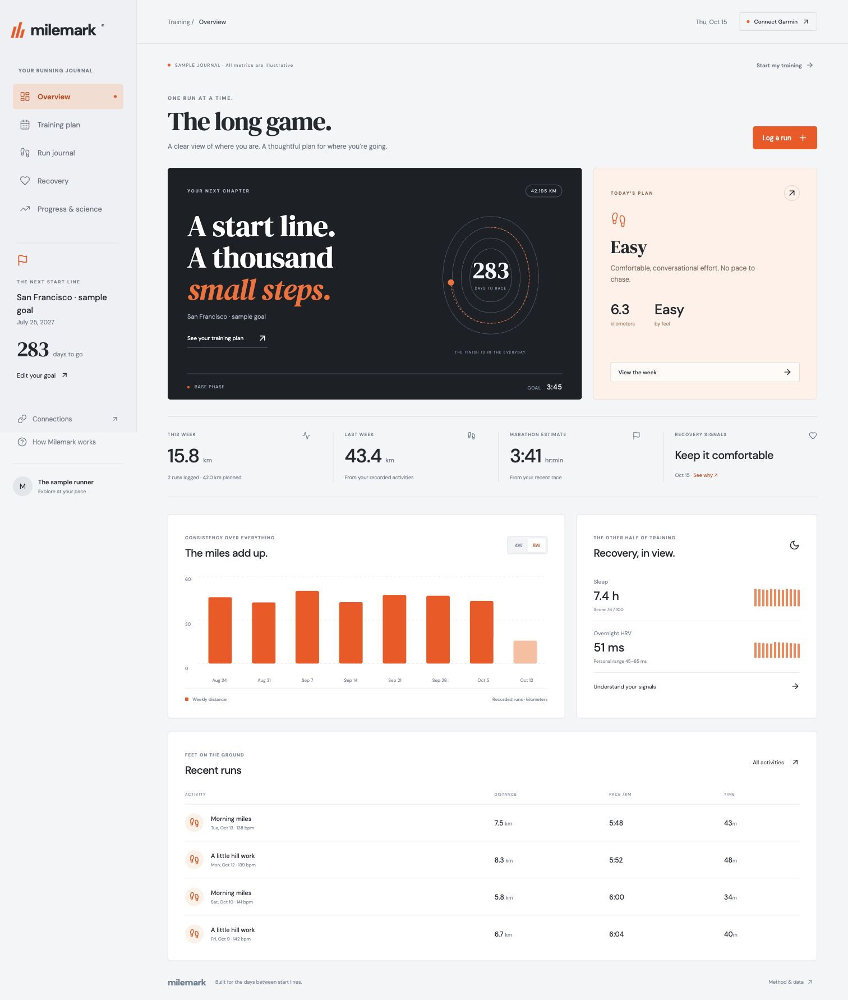

# Milemark

I built Milemark to keep marathon training, Garmin runs, and recovery history in one place. The app uses React, TypeScript, and a local Python service. It supports Garmin imports and a manual journal for runners without a watch.



[Source code](https://github.com/nikhiltrip/milemark) · [Setup](#run-locally) · [Automatic adjustments](#automatic-plan-adjustments) · [Verification notes](docs/verification.md)

[Hosted preview](https://milemark-nikhil.ntripathi11.chatgpt.site) requires the owner's ChatGPT sign-in. It supports synthetic demo data and a browser-local manual journal. Use the local setup below for Garmin sign-in and sync; the hosted preview cannot connect to the Garmin service on your laptop.

## What works

- Marathon selection: upcoming Los Angeles, Tokyo, Boston, and San Francisco events, plus a custom name and date. Preset dates link to organizer sources; past events are automatically hidden.
- A training template based on your current mileage, longest run, running days, and race date, with base weeks, recovery weeks, and a taper. Today's recovery readings and confirmed missed runs adjust the schedule and calendar export.
- Weekly and daily distance charts, manual run logging, recovery check-ins, sleep/HRV history, daily steps, and race-based marathon estimates. Multiple runs on one day contribute to a single daily total.
- VO₂ max, cadence, resting/max heart rate, running power, training effect, ground-contact time, and Garmin race predictions where the device provides them.
- A Progress & science page with source links, clear evidence limits, and comparisons of actual comparable race efforts.
- Local Garmin sign-in and MFA, cached session tokens, and read-only imports of runs, sleep, and HRV. Uses the **unofficial** `garminconnect` Python client, not Garmin's enterprise API.
- Miles by default, with a persistent miles/kilometers switch for distances, pace, goal inputs, and calendar exports. Stored/imported distances remain canonical kilometers.
- Browser-local manual mode for runners without Garmin. JSON import/export and `.ics` calendar downloads.
- Clearly labeled synthetic demo data. Personal data is never mixed with the sample runner.

**Live Garmin sign-in and read-only import were verified with the owner’s account on October 15, 2026.** The adapter uses installed `garminconnect` 0.3.18; login/MFA/data contracts also have fixture tests. Individual account behavior can differ. Garmin can change or restrict its services, and recovery metrics depend on the device.

## Run locally

Requirements: Node.js 20.19+ or 22.12+, npm, and Python 3.12+.

```sh
git clone https://github.com/nikhiltrip/milemark.git
cd milemark
```

For an existing clone, run `git pull --ff-only origin main` from a clean checkout of `main` before rebuilding. Back up uncommitted changes first; the update does not need to delete local Garmin data.

On macOS, double-click **`start.command`** (or run `./start.command` in Terminal). It prepares dependencies, builds the frontend, opens your browser, and starts the service on `http://127.0.0.1:8000`. Keep its Terminal window open; press Control-C to stop.

### Run from VS Code

Open the extracted project folder in VS Code, choose **Terminal → New Terminal**, and run this from the folder containing `start.command`:

```sh
bash start.command
```

This runs the same setup and local server as the launcher. If Finder displays an Apple verification warning for the downloaded launcher, you can inspect `start.command` in VS Code before running it. Keep the terminal open while using Milemark; press Control-C to stop it.

### Manual setup

Or set it up manually:

```sh
npm ci
python3.12 -m venv .venv
.venv/bin/python -m pip install -r backend/requirements.lock.txt
npm run build
PYTHONPATH=backend .venv/bin/python -m uvicorn milemark.app:app --host 127.0.0.1 --port 8000 --no-access-log
```

Open `http://127.0.0.1:8000`. Select **Connect Garmin**, sign in locally, enter Garmin's verification code if requested, then choose **Sync my Garmin**. Sync can take a few minutes. To build your plan from imported training, open **Edit your goal → Use my last 4 complete weeks** and review the numbers before saving.

### Missing today's sleep score or HRV?

1. Sync your watch in **Garmin Connect** and confirm today's readings appear there.
2. In Milemark, open **Connections → Sync my Garmin** and wait for the import to finish.
3. Check the **Latest available** date on Recovery. If Garmin Connect has no reading for today, Milemark cannot import one yet.

Opening or refreshing Milemark loads its saved import; it does not start a new Garmin sync. Overview and Recovery show a reminder when Garmin is connected but today's sleep score or overnight HRV is missing. Missing readings remain unavailable rather than being filled with sample values.

No Garmin? Choose **Start my training**, select your race and current training volume, then log runs manually. Goal time and mileage defaults are editable examples, not measurements of your fitness.

### Development

```sh
# Terminal 1: local Python API
PYTHONPATH=backend .venv/bin/python -m uvicorn milemark.app:app --host 127.0.0.1 --port 8000 --no-access-log
# Terminal 2: React with hot reload, API proxied to Python
npm run dev
```

The frontend is also a static app: `npm run build` produces `dist/`. Its hosted preview supports demo/manual mode; Garmin authentication is deliberately available only in the local Python app. It does not expose the laptop's API to the internet.

## How planning works

The plan keeps its original start date across reloads. Editing a goal starts a new schedule from the current week.

The engine is deterministic and inspectable in `frontend/src/engine.ts` and `frontend/src/adaptation.ts`. It is **not a trained ML model** or a medical assessment.

- Earlier months progressively build the base toward an explicit peak-mileage target instead of freezing the starting volume. The default four-day target is 35 miles/week; goal settings let the runner edit it.
- Progression is calculated from starting volume, target peak, and available growth weeks, capped at 6% between ordinary build weeks. Every fourth week is reduced. If the target is unreachable within the timeline, the app shows the attainable peak and warns rather than forcing the mileage. These are app parameters, not proven injury-prevention thresholds.
- Long runs: no more than 18 miles or 45–50% of weekly volume, depending on running frequency. Schedules preserve at least one nonrunning day. Short timelines generate explicit warnings.
- Finish estimate: the Riegel formula with exponent 1.06, using an explicitly marked race or user-entered race time. Easy training runs are never treated as race efforts. Course, weather, durability, and training history can make actual results differ substantially.
- Goal pace is a target, not proof of current ability. Most sessions use conversational effort rather than an unsupported pace prescription.

Research-to-code mappings and limitations are visible in the app and in `frontend/src/evidence.ts`. Software tests do not prove training effectiveness.

The [B.A.A. training materials](https://www.baa.org/races/boston-marathon/info-for-athletes/boston-marathon-training/) informed the structure of base/build/recovery work; this app does not reproduce a B.A.A. plan. [Garmin's HRV guide](https://www.garmin.com/en-US/garmin-technology/health-science/hrv-status/) explains why personal baselines matter.

## Automatic plan adjustments

1. Open **Connections → Sync my Garmin**, or save today's readings on **Recovery → Add check-in**. Saving a run or check-in recalculates the plan; opening the app only loads the last saved Garmin import.
2. In **Training plan**, read **Your adjusted schedule**. Changed sessions show an **Adjusted** label, the reason, and their original distance in the session detail.
3. For a manually tracked missed workout, select a scheduled session dated today or earlier and choose **Mark this run missed**. Use **Undo missed mark** to reverse that explicit mark. To let the app identify past scheduled days without runs, first finish entering your journal and choose **I've logged all runs through yesterday**.
4. Export the calendar again after changes. The `.ics` file contains the current adjusted schedule; Milemark does not update an external calendar you previously imported.

| Input | Schedule behavior |
| --- | --- |
| Today's sleep below 6 hours, sleep score below 60, or seven-day HRV outside the personal baseline | Make an uncompleted training session easy and at least 20% shorter. An existing larger reduction takes precedence. |
| A recovery flag today and on either of the previous two days | Cut today's uncompleted training by at least 30%; keep scheduled sessions over the next two days easy and at most 80% of their original distance. New readings recalculate the decision. |
| A confirmed missed session today or within the past two days | Drop its distance. Make the first uncompleted scheduled run within the coming three days shorter and easy. Keep rest days in place. |
| At least two missed sessions in a completed week | Use recorded volume from the most recent interrupted week to lower future targets, with a reduction capped at 50%. Relax that reduction by a factor of 1.06 per week from the week after the interruption, without exceeding the original schedule. |
| Missing or stale recovery readings, or an incomplete activity import | Do not infer a new recovery flag or a missed run from unavailable information. |

A complete Garmin import establishes missing-run coverage only through the day before that import, within its 365-day activity window. A 1,000-activity limit or partial-import warning disables that inference. Manual confirmation establishes coverage through the date you confirm. Recording a run takes priority over a missed mark; one recorded run on a date counts as a recorded session, even if shorter than the original target.

The original template remains the reference. Repeated refreshes do not compound cuts. Completed sessions, the race distance/date, taper dates, and rest days stay fixed. Calendar sessions, weekly totals, the Overview, and calendar exports use the same adjusted schedule. Missed mileage is never added to another workout.

Personal/demo mode, journal records, and manual decisions persist in this browser. JSON journal exports include missed marks and the confirmed-through date; goal settings remain separate browser-local settings. Importing a journal replaces its records and manual decisions. Saving a new goal starts a new schedule and resets missed marks and coverage confirmation. Garmin sync remains on demand, and the app does not fetch readings while closed.

The sleep thresholds, distance cuts, recovery buffer, and rebuild factors are app heuristics. I have not validated this algorithm in a training-outcomes trial. The [athlete-sleep consensus review](https://pubmed.ncbi.nlm.nih.gov/33144349/) supports individualized sleep assessment; it does not validate these numerical rules.

## Data & privacy

The local Python service stores only normalized run/recovery summaries in ignored `backend/data/milemark.sqlite3`. Session tokens are stored separately in ignored `backend/data/garmin/` with owner-only permissions. Passwords are not saved. Raw Garmin responses, GPS tracks, and account profile details are not exported or committed.

Browser manual records and settings use local storage. Export before clearing browser data. **Disconnect & remove local import** clears the local Garmin tokens, cached snapshot, and current browser journal. It does not revoke tokens already issued by Garmin; use Garmin account settings for revocation if needed. JSON imports replace the browser journal. Exported journals contain personal activity/recovery information, so review them before sharing.

The backend binds to loopback, checks Host/Origin, requires a per-process request token for mutations, redacts Garmin exception details, and rejects overlapping sync/login requests. This is a single-user local tool, not a multi-user hosted authentication service. Don't bind it to a public network interface.

Garmin's [official developer program](https://developer.garmin.com/gc-developer-program/program-faq/) requires approval for business use. A future supported multi-user integration should use that program rather than collecting Garmin passwords on a hosted website.

## Checks

```sh
npm test
npm run build
PYTHONPATH=backend .venv/bin/python -m pytest backend/tests -q
```

**Last checked November 10, 2026:** 31 TypeScript tests and 13 Python tests passed, along with the production build. [GitHub Actions run 42929416317](https://github.com/nikhiltrip/milemark/actions/runs/42929416317) passed for the adaptive-plan release at `0b473c6`.

Tests cover sleep/repeated flags, confirmed misses versus unavailable history, noncompounding adjustments, rebuild persistence, unchanged race/taper timing, calendar output and units, import validation, Garmin contracts, API protection, and cache preservation. Browser checks covered missed-mark/undo, a synthetic five-hour check-in, personal-mode persistence after reload, and a 390px layout without horizontal overflow. These checks did not perform a new live Garmin login or establish training effectiveness. See [verification notes](docs/verification.md).

## Structure

```text
frontend/src/       React dashboard, base/adaptive planning, import validation, tests
backend/milemark/  FastAPI service and read-only Garmin adapter
backend/tests/     Integration-contract and local API tests
public/fonts/      Self-hosted fonts and their OFL licenses
docs/              Architecture and verification notes
```

Built as an independent personal project. Not affiliated with Garmin, Strava, or any race organizer. Font licenses are included under `public/fonts/`.

Daily history: Recovery includes Garmin daily step totals and inspectable sleep/HRV charts. Run journal and Overview show daily running distance; multiple runs on the same date are summed once per activity ID. Hover, tap, or keyboard-focus a bar for its dated reading. All-day steps include walking and never increase running mileage or alter the training plan. Sync imports up to 365 days / 1,000 activities, backfills the latest 28 days of daily health records, and retains previously imported health records locally; it does not run while the app is closed.

Only Garmin running activity types enter the run journal and training calculations. Swimming, cycling, walking, hiking, and combined multisport summaries are excluded. Garmin recovery/readiness is displayed as returned by Garmin and can reflect overall activity; Milemark's own running-mileage calculations use runs only.
