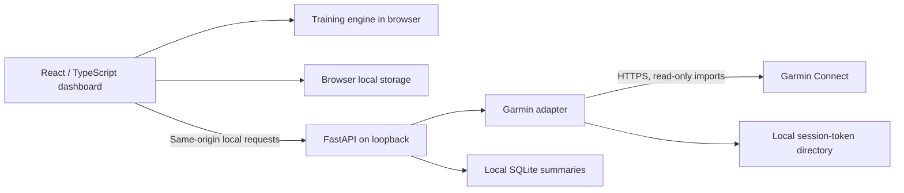

# Architecture

Milemark has two intentionally separate execution modes sharing one frontend.

The hosted static version supports the demo and manual mode. It does not reach the local API, accept Garmin credentials, or sync Garmin data by itself. The local Python service serves the same built frontend and adds a same-origin API.

## Python integration

`garmin.py` isolates the external client contract. The login handler uses an in-memory client for MFA continuation; tokens are persisted only after success. A fresh login through the cached session loads the profile required by sleep requests. Plaintext passwords are discarded after login initiation. No credentials appear in source or browser storage.

Sync imports up to one year / 1,000 most recent activities and 28 days of sleep/HRV through bulk endpoints, with recent sleep-detail fallback. Activity retrieval failure preserves the previous SQLite snapshot. A missing health endpoint produces a warning and null metrics rather than a fabricated score. The browser timezone selects the sync day. Fresh non-null imports replace previously missing cached fields; the UI shows the latest available metric with its date. VO₂ max checks 90 days of Garmin max metrics plus activity summaries. Race flags come from structured event metadata, not a name heuristic. Summaries omit location and raw account payloads.

The single-user service serializes Garmin operations, limits login retries, rejects remote clients/foreign origins, and requires a browser-request token on mutations. Tokens and the database are ignored by Git. Live Garmin sign-in and sync have been verified with the owner’s account.

## TypeScript domain logic

Unit conversion happens at display/input/export boundaries. Stored distances stay in kilometers, and pace converts by the same exact 1.609344 factor.

The engine handles local-calendar dates at noon to avoid UTC date shifts. Plans use a stable Monday-based calendar with an exact race-day event and no postrace running. Test cases cover Sunday and midweek races.

Current volume is always explicit. Imported activity history can prefill a recent four-complete-week average and a longest recent run, which the runner reviews in goal settings. A goal time never invents physiological data or guarantees an outcome. Peak volume is an explicit target (35 miles/week by default on four days), rather than a fixed multiple of a potentially low starting base.

The browser maintains a labeled sample mode separately from the personal journal. Imports validate dates, finite numbers, array limits, and units. Exports use a small normalized schema that excludes credentials and GPS points.

## Adaptive planning and state

`engine.ts` generates the base calendar. `adaptation.ts` derives the displayed schedule from that template, imported runs, dated recovery readings, and `PlanTracking` decisions. It recalculates rather than applying a second reduction to an already adjusted plan.

A complete Garmin activity import establishes missing-run coverage through the day before the import. Partial or activity-limited imports do not establish absence. Manual users can confirm journal coverage or mark individual sessions missed. Recorded runs override missed marks. The engine skips today-only recovery changes for sessions already recorded and preserves race distance and rest days.

An interrupted week anchors the rebuild factor to its own calendar date, so reopening the app does not restart the reduction. The UI uses the adjusted sessions for its cards, totals, and `.ics` export. Exporting creates a file; it does not synchronize changes to an external calendar.

Browser local storage holds personal/demo mode, goal settings, the journal, and manual tracking decisions. JSON journal exports include `planTracking`; they do not include goal settings or Garmin credentials. Saving a new goal clears manual tracking decisions. The date refreshes on window focus and every minute while the app is open. This does not schedule Garmin network requests.

## Known limits

- Unofficial Garmin services can change, require MFA, rate-limit, or reject a login. This project does not claim approved Garmin partner status.
- Sync is on demand. No background automation or workout upload is implemented.
- Plans are configurable heuristics. Injury history, terrain, heat, nutrition, and coach judgment are not modeled.
- Hosted manual storage belongs to that browser/origin; it does not synchronize across devices.
- Event presets are a curated list verified October 15, 2026, not a live race-directory feed. Organizer links remain visible and expired dates are filtered.
- Each new account still requires its owner to sign in locally.
